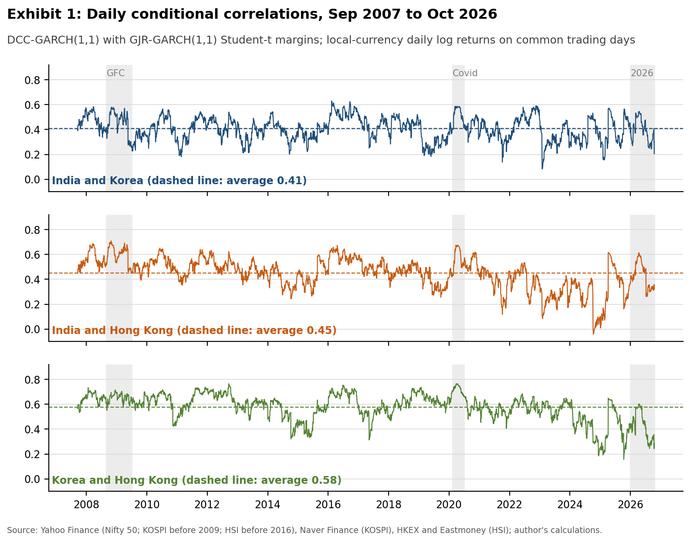
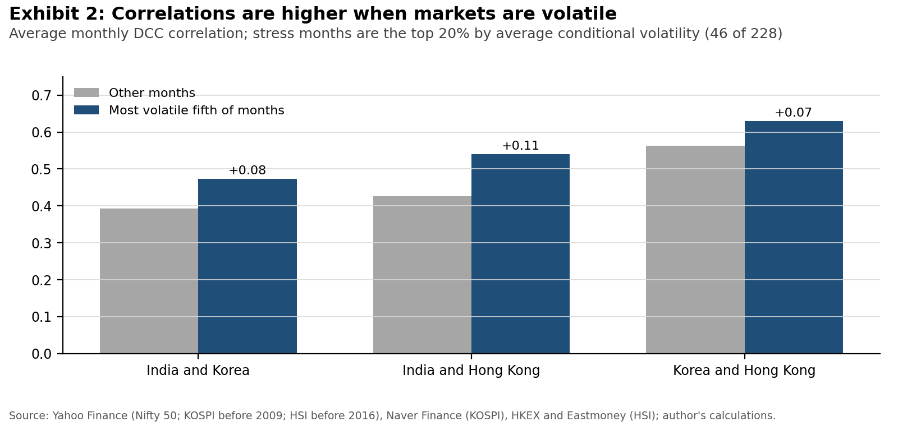
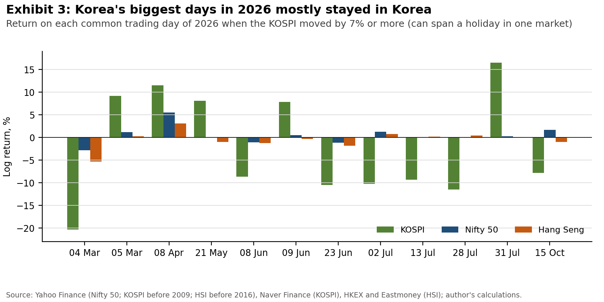

# When Korea shook in 2026, India and Hong Kong barely moved

*Nineteen years of daily data on how closely Asia's equity markets move together, and when the links tighten*

On 31 July 2026 the KOSPI rose 17.9%, the largest one-day gain in its history, a few days after a single-session fall of almost 11%. Across 2026 the index has swung with an annualised volatility of 67%, more than three times its 2021-2025 level. For anyone holding a basket of Asian equities, the obvious question is whether this was a Korean event or an Asian one.

This note looks at how closely three markets move together: India's Nifty 50, Korea's KOSPI and Hong Kong's Hang Seng Index. The data cover 4,305 days on which all three traded, from September 2007 to October 2026.

A single correlation figure for 19 years hides most of what matters, so the model used here (DCC-GARCH) estimates a fresh correlation for every day. It first strips out each market's own swings in volatility, so that a calm year and a panic are not mixed up, and then lets the correlation drift as new data arrive. Exhibit 1 shows the result.

Over the full period the average correlation is 0.41 between India and Korea, 0.45 between India and Hong Kong and 0.58 between Korea and Hong Kong. A correlation around 0.4 means the markets share a direction more often than not but leave plenty of room to diverge.

Three findings stand out.

The first is that the links tighten under stress. In the most volatile fifth of months (46 of 228), correlations were 0.07 to 0.11 higher than in other months, and the difference is statistically significant for all three pairs (Exhibit 2). Diversification across these markets works least well exactly when it is needed most. During the global financial crisis the India and Hong Kong correlation averaged 0.60, and in the Covid shock of early 2020 the Korea and Hong Kong correlation averaged 0.72.

The second is that Hong Kong has drifted away from the other two. The India and Hong Kong correlation averaged 0.59 in 2008 and 0.24 in 2024. Korea and Hong Kong fell from 0.66 to 0.42 over the same years. The downward trend also shows up in a simpler check using 250-day rolling correlations. India and Korea, by contrast, show no clear trend. The data alone cannot say why. One possible reading is that Hong Kong now tracks mainland China's own cycle more closely, while Indian equities are driven more by domestic savers, but both ideas need separate testing.

The third is that Korea's 2026 storm mostly stayed in Korea. The KOSPI moved by 7% or more on 12 days this year (Exhibit 3). On the nine of those days when every market had traded an ordinary single session, the KOSPI moved 9.9% on average, the Nifty 0.65% and the Hang Seng 0.72%. Measured another way, a 1% move in the KOSPI went with a 0.31% move in the Nifty over 2021-2025 but only 0.10% in 2026; for the Hang Seng the figure fell from 0.63% to 0.10%. Press coverage tied the swings to two chip makers, Samsung Electronics and SK hynix, and to doubts about AI spending ([Seoul Economic Daily, 31 July 2026](https://en.sedaily.com/finance/2026/07/31/kospi-whipsaws-18-percent-plunge-over-three-days-then-18)), which helps explain why the shock was so local.

The two exceptions in Exhibit 3, 4 March and 8 April, are partly a data effect. Holidays in India and Korea in early March, and in Hong Kong in early April, meant those returns covered several sessions in at least one market. Longer windows give shared global news more time to reach all three.

One caution applies to any comparison of Asian markets on daily data. Seoul closes at 06:30 UTC, Hong Kong at 08:00 and Mumbai at 10:00, so news that arrives in the Asian afternoon reaches the Nifty the same day but the KOSPI only the next morning. This makes daily correlations look weaker than the real link. On weekly returns the India and Korea correlation is 0.54 rather than 0.43, and today's Nifty move is correlated 0.09 with tomorrow's KOSPI move, against 0.03 the other way round.

For investors, an Asian basket diversifies less in a crisis than its average correlations suggest. For anyone watching for contagion, 2026 is a reminder that a dramatic move in one market is not the same thing as contagion: Korea's record swings left India and Hong Kong largely untouched. And the long fall in Hong Kong's correlation with India and Korea means these three markets are less tied together than they were a decade ago.

*Method: local-currency daily log returns on common trading days. Each market gets a GJR-GARCH(1,1) model with Student-t errors; the standardised residuals feed a DCC(1,1) model (Engle, 2002), estimated in two steps (a = 0.021, b = 0.969). Stress and trend tests use monthly averages with Newey-West standard errors. Data: Yahoo Finance, Naver Finance, HKEX and Eastmoney via public GitHub mirrors, cross-checked against each other on overlapping dates. Price indices only, so dividends are excluded. Code, tests and data checks: [github.com/tanaym136-byte/asia-equity-integration](https://github.com/tanaym136-byte/asia-equity-integration).*
